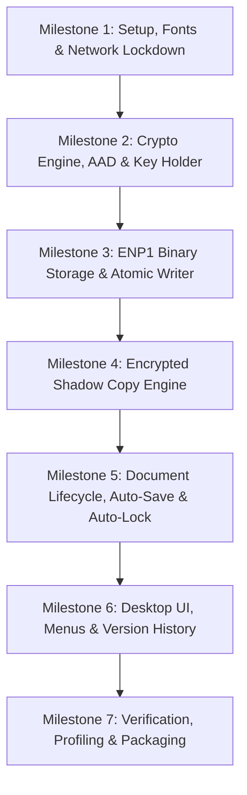

# Detailed Implementation Plan: EncNotePad (Revised)

**Project:** EncNotePad  
**Target Platform (Phase 1):** Windows Desktop (x64)  
**Target Platforms (Phase 2):** Android & iOS  
**Framework:** Flutter 3.x (Dart 3.x)  
**Security Model:** 100% Offline, Zero-Knowledge, AES-256-GCM + Argon2id, Encrypted On-Device Shadow Copies  
**Target Completion:** Production-Ready Phase 1 MVP  

---

## 0. Spec Alignment & Cryptographic Clarifications

Before implementation, the following clarifications bridge gaps between the original specification and production cryptography requirements (to be reflected back into `requirement.md` Section 3.2 & Section 4):

1. **KDF Algorithm Identifier in `ENP1` Header (1 Byte):** To guarantee cross-device decryption when the PBKDF2 fallback is used, the binary header adds a 1-byte `KDF ID` field (`0x01` = Argon2id, `0x02` = PBKDF2-HMAC-SHA256) immediately after `Version`. The full 34-byte header is passed as **AES-256-GCM Additional Authenticated Data (AAD)** so header tampering fails authentication.
2. **Shadow Copy Key & Salt Reuse:** All shadow copies for a document reuse the document's active 16-byte `Salt` and derived `SessionKey`, while generating a **fresh, cryptographically random 12-byte Nonce** per snapshot. This enables instant in-memory preview and rollback without caching the user's raw password.
3. **Zero Plaintext Manifest:** To strictly uphold the Zero Plaintext Persistence principle, the shadow copy manifest (`manifest.json.enc`) is encrypted with the active `SessionKey` using AES-256-GCM.
4. **Standardized Naming:** Transient atomic files use `.<filename>.enp.tmp` (hidden on Windows), shadow directories use `.<filename>_shadows/` (hidden on Windows), and snapshots use `shadow_<seq3>_<YYYYMMDD_HHMMSS>.enp`.
5. **Phase 1 Scope Discipline:** Features not present in `requirement.md` (such as *Change Password*, which requires transactional re-encryption of all shadow copies or a KDF-wrapped DEK architecture) are deferred to Phase 1.1 so Phase 1 remains tightly aligned and auditable.

---

## 1. Project Directory Architecture

The project follows a **Clean Architecture / Feature-First** structure to enforce clear boundaries between cryptographic isolates, single-owner key lifecycle management, state orchestration, and UI widgets.

```text
d:\EncNotePad\
├── requirement.md
├── IMPLEMENTATION_PLAN.md
└── encnotepad/                             # Flutter project root
    ├── analysis_options.yaml               # Strict static analysis rules
    ├── pubspec.yaml                        # Locked dependencies & Noto font assets
    ├── assets/
    │   └── fonts/                          # Bundled Noto Sans & Indian script fonts
    ├── windows/                            # Windows native C++ runner
    ├── android/                            # Android project (no INTERNET permission)
    ├── ios/                                # iOS project (no network entitlements)
    ├── test/                               # Unit, widget, storage, and crypto tests
    │   ├── crypto/
    │   ├── storage/
    │   ├── state/
    │   └── ui/
    └── lib/
        ├── main.dart                       # App entrypoint & window configuration
        ├── core/                           # Shared platform, crypto, storage, settings
        │   ├── constants/
        │   │   ├── app_constants.dart
        │   │   └── crypto_constants.dart
        │   ├── crypto/
        │   │   ├── session_key_holder.dart # Single exclusive owner of active SessionKey
        │   │   ├── crypto_isolate.dart     # Background worker for KDF & AES-256-GCM
        │   │   ├── aes_gcm_service.dart    # AES-256-GCM encryption/decryption + AAD
        │   │   ├── kdf_service.dart        # Argon2id (native FFI) + PBKDF2 fallback
        │   │   └── memory_hygiene.dart     # Uint8List zeroization helpers
        │   ├── storage/
        │   │   ├── binary_file_format.dart # ENP1 34-byte header parser & serializer
        │   │   ├── atomic_file_writer.dart # Write-to-hidden-tmp, flush, atomic rename
        │   │   ├── windows_file_attrs.dart # Win32 SetFileAttributesW hidden helper
        │   │   └── shadow_copy_manager.dart# Local snapshots, encrypted manifest, FIFO
        │   ├── settings/
        │   │   └── app_settings_service.dart # Non-sensitive prefs (auto-lock timeout)
        │   ├── theme/
        │   │   ├── app_theme.dart          # Typography & visual hierarchy
        │   │   └── font_stack.dart         # Unicode & Indian script fallback stack
        │   └── utils/
        │       ├── debouncer.dart          # 500ms auto-save debouncer
        │       └── inactivity_tracker.dart # Configurable inactivity auto-lock timer
        └── features/
            ├── document/
            │   ├── domain/
            │   │   ├── document_model.dart # Document, Meta, Section, Part models
            │   │   └── document_mapper.dart# Strict UTF-8 JSON serializer/deserializer
            │   ├── state/
            │   │   ├── document_bloc.dart  # Document lifecycle & edit state machine
            │   │   ├── document_event.dart
            │   │   └── document_state.dart
            │   └── ui/
            │       ├── idle_screen.dart    # Launch & post-close landing view
            │       ├── editor_screen.dart  # Main desktop workspace
            │       └── widgets/
            │           ├── desktop_menu_bar.dart # File, Edit, Security, Help menus
            │           ├── editor_toolbar.dart   # Search, Add Section, Shadows, Lock
            │           ├── section_card.dart     # Collapsible block + ▲/▼/🗑 + count
            │           ├── part_tile.dart        # Title, body editor + ▲/▼/🗑
            │           └── status_footer.dart    # Save state, section & shadow counts
            ├── auth_lock/
            │   ├── state/
            │   │   └── lock_cubit.dart     # Lock/unlock & configurable timeout state
            │   └── ui/
            │       ├── new_document_dialog.dart  # Path, password, confirm, strength
            │       ├── open_password_dialog.dart # Password prompt + 500ms delay UX
            │       ├── lock_screen.dart          # Inactivity unlock overlay
            │       ├── auto_lock_settings_dialog.dart # Timeout configuration modal
            │       └── password_strength.dart    # Real-time entropy/strength meter
            └── shadow_copies/
                ├── domain/
                │   └── shadow_model.dart   # Snapshot metadata & trigger enum
                └── ui/
                    └── version_history_dialog.dart # List, preview, export, restore
```

---

## 2. Technical Stack & Vetted Dependencies

| Package | Purpose | Justification |
| :--- | :--- | :--- |
| `cryptography: ^2.7.0` | AES-256-GCM & PBKDF2-HMAC-SHA256 | Constant-time, audited Dart crypto primitives with AAD support. |
| `sodium_libs` (or native FFI `argon2`) | Native Argon2id Key Derivation | True native C/FFI RFC 9106 Argon2id (`m=64MB, t=3, p=4`) avoiding multi-second pure-Dart slowdowns. Benchmarked in Milestone 1 before locking. |
| `flutter_bloc: ^8.1.3` | State Management | Deterministic event-driven state transitions (`Idle` -> `Editing` -> `Locked`). |
| `equatable: ^2.0.5` | Value Equality | Clean immutable state comparisons for `DocumentBloc` and `LockCubit`. |
| `file_picker: ^8.0.0` | Native File Dialogs | Native Windows Explorer dialogs for New, Open, and `Export Copy...`. |
| `path_provider: ^2.1.2` | App Support Directory | Stores **only** non-sensitive app preferences (e.g., configurable auto-lock timeout). Never stores notes or keys. |
| `uuid: ^4.4.0` | Unique IDs | Generates RFC 4122 v4 UUIDs formatted as `sec_<uuid>` and `prt_<uuid>`. |
| `window_manager: ^0.3.8` | Desktop Window Controls | Default/minimum window sizing, title updates, and close-interception flush hooks. |
| `win32: ^5.5.0` & `ffi: ^2.1.0` | Windows File Attributes | Calls `SetFileAttributesW` to mark `.<name>_shadows/` and `.<name>.enp.tmp` as hidden on Windows. |

---

## 3. Step-by-Step Implementation Roadmap

### Phase 1: MVP Delivery Status (Completed & Verified)
- [x] **Milestone 1: Setup & Tooling Configuration** - Flutter project, strict lints, air-gapped network lockdown.
- [x] **Milestone 2: Cryptographic Engine & Isolates** - AES-256-GCM + PBKDF2/Argon2id, background isolate execution, RAM zeroization.
- [x] **Milestone 3: Binary Storage & Atomic Persistence** - `ENP1` header parser/serializer, atomic write (`.tmp` -> rename), JSON schema.
- [x] **Milestone 4: On-Device Shadow Copy Engine** - Hidden snapshot folder, encrypted manifest, 15-snapshot FIFO pruning, preview/rollback.
- [x] **Milestone 5: Document State Management** - `DocumentBloc`, 10s auto-save debounce with `Ctrl+S` bypass, 15-min milestones, 5-min auto-lock.
- [x] **Milestone 6: Desktop User Interface** - Idle screen, password strength meter, hierarchical card editor, version history dialog, native Windows `.enp` file association.
- [x] **Milestone 7: Verification & Release Packaging** - Automated test suite passing, debug and release desktop binaries built.



---

### Milestone 1: Project Setup, Font Bundling & Tooling Configuration
* **Task 1.1: Flutter Project Initialization & Strict Lints**
  * Run `flutter create --org com.encnotepad --platforms=windows,android,ios encnotepad`.
  * Configure `analysis_options.yaml` with `strict-casts: true`, `strict-inference: true`, and `strict-raw-types: true`.
* **Task 1.2: Air-Gap / Network Lockdown**
  * Android: Ensure `android.permission.INTERNET` is absent from all `AndroidManifest.xml` variants (main/profile/release).
  * Windows & iOS: Verify zero network entitlements, HTTP packages, or telemetry SDKs exist in `pubspec.lock`.
* **Task 1.3: Bundled Typography & Indian Script Assets**
  * Bundle open-source **Noto Sans** families (`NotoSans`, `NotoSansDevanagari`, `NotoSansTamil`, `NotoSansBengali`, `NotoSansTelugu`, `NotoSansGujarati`) under `assets/fonts/` and register them in `pubspec.yaml`.
  * Define `font_stack.dart` with Noto Sans primary fonts and Windows `Nirmala UI` / `Segoe UI Emoji` fallbacks.
* **Task 1.4: Argon2id Native FFI Benchmark Gate**
  * Run a quick native Windows benchmark verifying Argon2id (`64 MB, t=3, p=4`) completes in `< 500ms` inside an isolate. Reject any pure-Dart KDF implementation that stalls beyond 1 second.
* **Task 1.5: Window Manager & App Settings Service**
  * Initialize `window_manager` in `main.dart` with default `1100x750`, minimum `800x600`, and `setPreventClose(true)` so window exit flushes pending saves and wipes memory cleanly.
  * Implement `app_settings_service.dart` using `path_provider` to persist the configurable inactivity lock timeout (default: `5` minutes; allowed options: `1, 3, 5, 10, 15, 30` minutes).

---

### Milestone 2: Cryptographic Engine, Single Key Holder & Isolates
* **Task 2.1: Key Derivation Service (`kdf_service.dart`)**
  * Primary (`KDF ID = 0x01`): Argon2id (`Random.secure()` 16-byte salt, $m = 65536\text{ KiB}$, $t = 3$, $p = 4$, output = 32 bytes).
  * Fallback (`KDF ID = 0x02`): PBKDF2-HMAC-SHA256 (`600,000` iterations, 32-byte output) when Argon2 FFI is unavailable on a target platform.
  * Decryption automatically dispatches based on the file header's `KDF ID` byte.
* **Task 2.2: AES-256-GCM Engine (`aes_gcm_service.dart`)**
  * Key: 256 bits (32 bytes).
  * Nonce: Fresh 96-bit (12-byte) `Random.secure()` nonce generated on **every save and every shadow copy**.
  * AAD: Pass the 34-byte `ENP1` header (`Magic + Version + KDF ID + Salt + Nonce`) as Additional Authenticated Data.
  * Auth Tag: 128 bits (16 bytes).
* **Task 2.3: Background Isolate Worker (`crypto_isolate.dart`)**
  * Offload KDF derivation, UTF-8 JSON encoding/decoding, and AES-256-GCM encrypt/decrypt via `Isolate.run`.
  * Enforce a **minimum 500ms anti-brute-force delay** on any failed decryption/authentication attempt before returning an error to the UI.
* **Task 2.4: Single `SessionKeyHolder` & Realistic RAM Hygiene (`session_key_holder.dart`, `memory_hygiene.dart`)**
  * `SessionKeyHolder` is the **sole owner** of `_sessionKey` (`Uint8List`), `_documentSalt` (`Uint8List`), and `_kdfType`. Neither `DocumentBloc` nor `LockCubit` stores copies of raw key bytes.
  * `wipeBuffer(Uint8List)` fills byte arrays with `0x00` inside `finally` blocks for temporary password UTF-8 bytes, plaintext JSON bytes, and active key buffers on lock/close.
  * Document Dart `String` immutability constraint: immediately `.clear()` and `dispose()` all password `TextEditingController`s on dialog close, and clear all `Document` references on Lock/Close so GC can reclaim heap strings.
* **Task 2.5: Cryptographic Unit Tests**
  * Round-trip encryption/decryption for both Argon2id (`0x01`) and PBKDF2 (`0x02`) headers.
  * Wrong password fails auth tag verification and enforces $\ge 500\text{ms}$ delay.
  * 1-bit mutation in header (AAD), ciphertext, or auth tag is rejected.
  * Consecutive saves produce distinct 12-byte nonces and distinct ciphertexts.

---

### Milestone 3: Binary Storage, Document Schema & Atomic Persistence
* **Task 3.1: Binary File Formatter (`binary_file_format.dart`)**
  * Exact binary layout:
    `[Magic: 'ENP1' (4B)] + [Version: 0x01 (1B)] + [KDF ID: 0x01|0x02 (1B)] + [Salt: 16B] + [Nonce: 12B] + [Ciphertext: VarB] + [Tag: 16B]`
  * Strict validation of magic bytes (`0x45, 0x4E, 0x50, 0x31`), supported version (`0x01`), known KDF ID, and minimum byte length ($\ge 50$ bytes).
* **Task 3.2: Atomic File Writer & Windows Hidden Attributes (`atomic_file_writer.dart`, `windows_file_attrs.dart`)**
  * Write encrypted bytes to `.<filename>.enp.tmp` in the same directory.
  * Mark `.<filename>.enp.tmp` hidden on Windows via `SetFileAttributesW` (`FILE_ATTRIBUTE_HIDDEN`).
  * Call `await raf.flush()` and `await raf.close()` to flush OS buffers to disk.
  * Atomically rename `.<filename>.enp.tmp` -> `<filename>.enp`. Clean up orphaned `.tmp` files on error.
* **Task 3.3: Strict In-Memory JSON Schema (`document_mapper.dart`)**
  * Enforce exact `requirement.md` schema:
    * `meta`: `version` (`"1.0"`), `app` (`"EncNotePad"`), `created_at` (ISO-8601 UTC), `updated_at` (ISO-8601 UTC).
    * `content`: ordered list of `Section` objects (`id: "sec_<uuid>"`, `title`, `is_collapsed`, `order`, `parts`).
    * `parts`: ordered list of `Part` objects (`id: "prt_<uuid>"`, `title`, `body`, `order`).
  * Enforce strict UTF-8 encoding/decoding and validate schema keys on load.

---

### Milestone 4: On-Device Shadow Copy Engine
* **Task 4.1: Shadow Repository Manager (`shadow_copy_manager.dart`)**
  * For document `D:\Notes\MyVault.enp`, manage directory `D:\Notes\.MyVault_shadows\`.
  * Automatically apply Windows `FILE_ATTRIBUTE_HIDDEN` attribute on directory creation via `windows_file_attrs.dart`.
* **Task 4.2: Encrypted Manifest (`manifest.json.enc`)**
  * Store snapshot metadata (`nextSequence`, list of entries with `filename`, `sequence`, `timestamp`, `triggerType`, `byteSize`, `sectionCount`) serialized as UTF-8 JSON and encrypted with the active `SessionKey` + fresh 12-byte nonce using the same `ENP1` format.
  * Write `manifest.json.enc` via `AtomicFileWriter` so zero plaintext metadata ever touches disk.
* **Task 4.3: Snapshot Triggers & Naming**
  * Naming convention: `shadow_<seq3>_<YYYYMMDD_HHMMSS>.enp` (e.g., `shadow_001_20261121_140000.enp`).
  * Reuse active document `Salt` + `SessionKey` with a fresh 12-byte random Nonce.
  * Implement all 5 snapshot triggers:
    1. **Initial Snapshot:** Created immediately upon creating a New Document (`shadow_001_...`).
    2. **Session Open Snapshot:** Created immediately after opening and decrypting an existing `.enp` file.
    3. **Milestone Snapshot:** Created after **15 minutes of cumulative active editing**.
    4. **Structural Change Snapshot:** Created automatically prior to/upon major structural mutations (such as deleting a Section).
    5. **Manual & Recovery Snapshots:** Created on `Ctrl+Shift+B` (`Manual`) and immediately after restoring a historical snapshot (`Recovery`).
* **Task 4.4: FIFO 15-Snapshot Rotation**
  * Keep a maximum of **15** snapshots per document. When the 16th snapshot is committed, delete the oldest snapshot file on disk and remove its entry from `manifest.json.enc`.
* **Task 4.5: Preview, Export Copy & Rollback**
  * **Encrypted Preview:** Load selected snapshot file, decrypt in background isolate with active `SessionKey`, and return a read-only `Document` object without mutating working state.
  * **Export Copy:** Copy the selected encrypted `.enp` snapshot verbatim to a user-selected destination path via `file_picker`.
  * **Restore:** Replace active in-memory `Document`, perform immediate atomic save to `<name>.enp`, and record a new `Recovery` shadow copy.

---

### Milestone 5: Document Lifecycle, Auto-Save & Auto-Lock
* **Task 5.1: DocumentBloc (`document_bloc.dart`)**
  * Lifecycle States: `DocumentIdle`, `DocumentLoading`, `DocumentEditing` (holds immutable `Document`, file path, `isDirty`, `isSaving`, `shadowCount`, search query), `DocumentLocked` (zero document data in state), `DocumentError`.
  * Events:
    * Lifecycle: `CreateNewDocument`, `OpenDocument`, `CloseDocument`, `LockDocument`, `UnlockDocument`
    * Structure & Content: `AddSection`, `DeleteSection`, `ReorderSection`, `ToggleSectionCollapse`, `UpdateSectionTitle`, `AddPart`, `DeletePart`, `ReorderPart`, `UpdatePartTitle`, `UpdatePartBody`
    * Persistence & History: `TriggerAutoSave`, `CreateManualShadowCopy`, `RestoreShadowCopy`, `ExportShadowCopy`
    * Search: `UpdateSearchQuery`, `ClearSearch`
  * **`CloseDocument` & Exit Flush:** Cancels debounce timer, forces immediate atomic save if dirty, calls `SessionKeyHolder.wipe()`, clears `Document` from state, and transitions to `DocumentIdle`.
* **Task 5.2: Debounced Auto-Save Pipeline & Active-Edit Timer**
  * 500ms debounce timer restarts on each text or structure edit; on elapse, updates `meta.updated_at`, encrypts in isolate, writes atomically, and updates status indicator (`"Saving..."` -> `"All changes saved (Local)"`).
  * Track cumulative active editing time (incrementing only while edits occur) to trigger the 15-minute Milestone Snapshot accurately without creating redundant snapshots during idle periods.
* **Task 5.3: Configurable Inactivity Auto-Lock (`inactivity_tracker.dart`, `lock_cubit.dart`)**
  * Wrap root app in a global `Listener` / `Focus` handler resetting the countdown on mouse clicks, scroll, or key presses.
  * Read timeout duration from `AppSettingsService` (default 5 minutes).
  * On timeout (or manual `Ctrl+L`): flush any pending dirty save, wipe `SessionKeyHolder`, drop in-memory `Document` state, and present `LockScreen` retaining only the active file path so the user can re-enter their password to re-decrypt.
* **Task 5.4: Live In-Memory Search**
  * Filter/highlight matches across section titles, part titles, and part bodies (`Ctrl+F`) without altering persisted `is_collapsed` flags.

---

### Milestone 6: Desktop User Interface (Windows)
* **Task 6.1: Idle / Welcome Screen (`idle_screen.dart`)**
  * Displayed on app launch and after `CloseDocument`.
  * Clean centered actions: **New Document (`Ctrl+N`)** and **Open Document (`Ctrl+O`)**, plus offline zero-knowledge badge.
* **Task 6.2: Window Title Bar & Desktop Menu Bar (`desktop_menu_bar.dart`)**
  * Window title displays `EncNotePad - [<filename>.enp]` with unsaved indicator when dirty.
  * Native/desktop menu bar matching `requirement.md`:
    * `File`: New (`Ctrl+N`), Open (`Ctrl+O`), Create Shadow Copy Now (`Ctrl+Shift+B`), Version History (Shadow Copies) (`Ctrl+H`), Close Document (`Ctrl+W`), Exit
    * `Edit`: Add Section (`Ctrl+Shift+S`), Find (`Ctrl+F`)
    * `Security`: Lock Now (`Ctrl+L`), Auto-Lock Timeout...
    * `Help`: Keyboard Shortcuts, About EncNotePad (Offline Security Info)
* **Task 6.3: Top Action Toolbar & Status Footer**
  * Toolbar (`editor_toolbar.dart`): `[🔍 Search notes... (Ctrl+F)]`, `[+ Add Section]`, `[🕒 Shadow Copies]`, `[🔒 Lock]`.
  * Status Footer (`status_footer.dart`): `Status: All changes saved (Local)` | `X Sections` | `Y Local Shadow Copies Available`.
* **Task 6.4: Hierarchical Card-Based Editor Canvas**
  * `section_card.dart`: Collapsible card header with inline title edit, reorder buttons (`▲` / `▼`), delete button (`🗑` with confirmation dialog triggering a structural snapshot), collapsed part summary (`(N parts collapsed)`), and `[+ Add Part]` footer button.
  * `part_tile.dart`: Nested card with inline editable Part Title, reorder (`▲` / `▼`) and delete (`🗑`) controls, and auto-expanding multi-line body `TextField`.
  * Visual hierarchy: Section Title 16pt Bold, Part Title 14pt Medium Bold, Part Body 11pt Regular.
* **Task 6.5: Auth, Lock & Settings Modals**
  * `new_document_dialog.dart`: File path picker, master password + confirmation fields, real-time strength meter (`password_strength.dart`).
  * `open_password_dialog.dart` & `lock_screen.dart`: Clean password entry, loading spinner during Argon2id isolate execution, and clear error feedback after the 500ms anti-brute-force delay.
  * `auto_lock_settings_dialog.dart`: Configure inactivity lock timeout (`1–30` minutes).
* **Task 6.6: Local Version History (Shadow Copies) Dialog (`version_history_dialog.dart`)**
  * Chronological list displaying **`Current Working File (Active)`** at the top, followed by up to 15 local snapshots with timestamp, trigger badge (`Session Open`, `Milestone`, `Structural`, `Manual`, `Recovery`), file size, and section count.
  * Read-only preview pane rendering sections and part titles/bodies of the selected snapshot.
  * Footer actions: `[ Close ]`, `[ Export Copy... ]`, and `[ Restore This Snapshot ]` (with confirmation prompt).
* **Task 6.7: Indian Language & Unicode Verification**
  * Test Windows TSF IME input, conjuncts, diacritics, and rendering for Hindi (Devanagari), Tamil, Bengali, Telugu, Gujarati, and Unicode emojis across Section titles, Part titles, Part bodies, and search queries.

---

### Milestone 7: Verification, Security Profiling & Release Packaging
* **Task 7.1: Automated Test Suite**
  * `test/crypto/`: Argon2id/PBKDF2 round-trips, AAD tamper detection, nonce uniqueness, 500ms failure floor.
  * `test/storage/`: `ENP1` packing/unpacking, atomic rename crash resilience, encrypted manifest round-trip, 15-snapshot FIFO eviction, Windows hidden attribute checks.
  * `test/state/`: `DocumentBloc` edit/debounce/close/lock flows, `SessionKeyHolder` zeroization, structural & 15-min milestone snapshot triggers.
  * `test/ui/`: Widget tests for Idle screen, Section/Part CRUD, Version History preview/restore, and Lock overlay.
* **Task 7.2: Security & Memory Audit (DevTools + Static Checks)**
  * Inspect heap & buffers via Flutter DevTools: verify `SessionKeyHolder` byte buffers are zeroed on Lock/Close and `DocumentEditing` state is fully released.
  * Verify on disk that **zero** plaintext strings appear in `.enp`, `.<name>_shadows/*.enp`, or `manifest.json.enc` (e.g., via binary `strings` scan).
  * Verify zero outbound network sockets/DNS requests during all workflows (air-gap test via Windows Firewall block / packet monitor).
* **Task 7.3: Performance Profiling**
  * Profile keystroke latency during 500ms debounced auto-save on large documents (100+ parts) to confirm consistent 60/120 FPS without frame drops.
* **Task 7.4: Windows Release Packaging**
  * Run `flutter build windows --release`.
  * Verify standalone portable folder execution on a clean Windows 10/11 x64 environment with bundled Noto fonts and native FFI libraries included.

---

## 4. Risk Analysis & Mitigation Matrix

| Identified Risk | Severity | Mitigation Strategy |
| :--- | :--- | :--- |
| **Pure-Dart Argon2id UI/Isolate Stall** | High | Benchmark native FFI Argon2id in Milestone 1 before building crypto services; always run inside `Isolate.run`. |
| **Header/KDF Mismatch Across Devices** | High | Include explicit 1-byte `KDF ID` in the 34-byte `ENP1` header and authenticate the entire header as AES-GCM AAD. |
| **Plaintext Metadata Leak in Shadow Manifest** | High | Encrypt `manifest.json.enc` with the active `SessionKey` using AES-256-GCM; never write unencrypted JSON to disk. |
| **File Corruption on Sudden Power Loss** | Critical | Write to hidden `.<name>.enp.tmp`, call `flush()`, then atomically rename to `<name>.enp`. |
| **Duplicate SessionKey Copies in Memory** | High | Enforce single ownership in `SessionKeyHolder`; zeroize buffers in one place on Lock, Close, and Window Exit. |
| **Dart String Immutability in RAM** | Medium | Zeroize all `Uint8List` crypto/password/JSON buffers immediately; clear and dispose `TextEditingController`s and drop `Document` references on Lock/Close. |
| **Accidental Section Deletion or Overwrite** | High | Trigger automatic structural shadow copy on Section deletion alongside baseline, 15-minute milestone, and manual snapshots (15-snapshot FIFO). |
| **Missing Glyphs for Indian Scripts** | Low | Bundle Noto Sans script font families directly in `assets/fonts/` with `Nirmala UI` fallback. |

---

## 5. Definition of Done (DoD) for Phase 1

1. [ ] App launches into `IdleScreen`; user can create a new `.enp` file with password confirmation, strength meter, and initial `shadow_001` snapshot.
2. [ ] User can open an existing `.enp` file; invalid passwords or tampered headers/ciphertexts fail cleanly with a $\ge 500\text{ms}$ anti-brute-force delay.
3. [ ] Binary `ENP1` header includes `KDF ID` (`0x01`/`0x02`) and is authenticated as AES-256-GCM AAD.
4. [ ] Auto-save persists edits 500ms after typing stops via hidden `.enp.tmp` -> `flush()` -> atomic rename with a unique 12-byte nonce per write.
5. [ ] Encrypted local shadow copies (and encrypted `manifest.json.enc`) are generated on New Document, Session Open, 15-min active milestones, Section deletion, Manual (`Ctrl+Shift+B`), and Restore, with 15-snapshot FIFO rotation.
6. [ ] Version History dialog displays `Current Working File (Active)` + up to 15 snapshots (timestamp, trigger, size, section count) with encrypted preview, `Export Copy...`, and one-click `Restore This Snapshot`.
7. [ ] Inactivity auto-lock timeout is configurable (default 5 min); locking or closing a document flushes dirty edits, zeroes `SessionKeyHolder` buffers, and releases document state.
8. [ ] Menu bar (`File`, `Edit`, `Security`, `Help`), toolbar, card reorder/delete controls, collapsed part counts, and status footer match `requirement.md`.
9. [ ] Hindi, Tamil, Bengali, Telugu, Gujarati, and emojis render and accept Windows IME input accurately.
10. [ ] Binary scan confirms zero plaintext on disk and air-gap test confirms zero network activity.
11. [ ] `flutter build windows --release` produces a verified standalone x64 build.