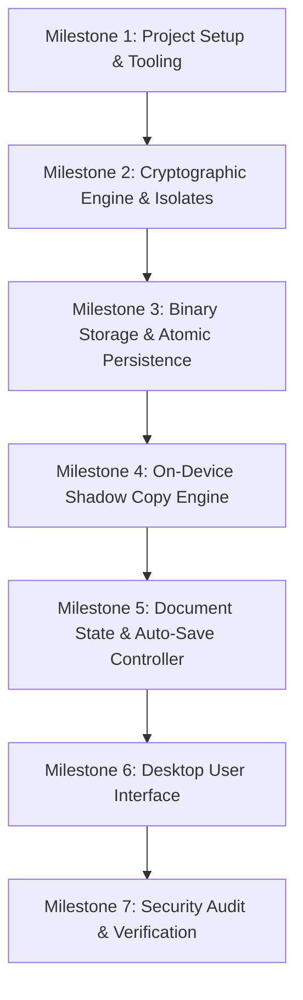

# Detailed Implementation Plan: EncNotePad

**Project:** EncNotePad  
**Target Platform (Phase 1):** Windows Desktop (x64)  
**Target Platforms (Phase 2):** Android & iOS  
**Framework:** Flutter 3.x (Dart 3.x)  
**Security Model:** 100% Offline, Zero-Knowledge, AES-256-GCM + Argon2id, On-Device Shadow Copies  
**Target Completion:** Production-Ready Phase 1 MVP  

---

## 1. Project Directory Architecture

The project will follow a **Clean Architecture / Feature-First** structure to enforce separation of concerns, testability, and isolate boundaries.

```
d:\EncNotePad\
├── requirement.md
├── IMPLEMENTATION_PLAN.md
└── encnotepad/                         # Flutter project root
    ├── analysis_options.yaml           # Strict static analysis rules
    ├── pubspec.yaml                    # Locked dependencies
    ├── windows/                        # Windows native C++ runner
    ├── android/                        # Android project (no INTERNET permission)
    ├── ios/                            # iOS project
    ├── test/                           # Unit, widget, and crypto tests
    │   ├── crypto/
    │   ├── storage/
    │   ├── state/
    │   └── ui/
    └── lib/
        ├── main.dart                   # App entrypoint & window configuration
        ├── core/                       # Shared platform, crypto, and storage
        │   ├── constants/
        │   │   ├── app_constants.dart
        │   │   └── crypto_constants.dart
        │   ├── crypto/
        │   │   ├── crypto_isolate.dart       # Background worker for KDF & AES
        │   │   ├── aes_gcm_service.dart      # AES-256-GCM encryption/decryption
        │   │   ├── argon2_service.dart       # Argon2id key derivation
        │   │   └── memory_hygiene.dart       # Uint8List zeroization helpers
        │   ├── storage/
        │   │   ├── binary_file_format.dart   # ENP1 header parser & serializer
        │   │   ├── atomic_file_writer.dart   # Write-to-temp and atomic rename
        │   │   └── shadow_copy_manager.dart  # Local snapshots & FIFO rotation
        │   ├── theme/
        │   │   ├── app_theme.dart            # Typography & colors
        │   │   └── font_stack.dart           # Unicode & Indian script fallback
        │   └── utils/
        │       ├── debouncer.dart            # 500ms auto-save debouncer
        │       └── inactivity_tracker.dart   # 5-min auto-lock timer
        └── features/
            ├── document/
            │   ├── domain/
            │   │   ├── document_model.dart   # Document, Section, Part models
            │   │   └── document_mapper.dart  # JSON serializer/deserializer
            │   ├── state/
            │   │   ├── document_bloc.dart    # Document state management
            │   │   ├── document_event.dart
            │   │   └── document_state.dart
            │   └── ui/
            │       ├── editor_screen.dart    # Main card-based canvas
            │       ├── widgets/
            │       │   ├── section_card.dart # Collapsible section block
            │       │   ├── part_tile.dart    # Title & multiline body editor
            │       │   ├── editor_app_bar.dart
            │       │   ├── status_footer.dart# Save/lock status bar
            │       │   └── search_bar.dart   # In-document search
            ├── auth_lock/
            │   ├── state/
            │   │   └── lock_cubit.dart       # Session key & lock state
            │   └── ui/
            │       ├── password_dialog.dart  # Master password modal
            │       ├── lock_screen.dart      # Inactivity unlock overlay
            │       └── password_strength.dart# Real-time entropy meter
            └── shadow_copies/
                ├── domain/
                │   └── shadow_model.dart     # Snapshot metadata
                └── ui/
                    └── version_history_dialog.dart # Preview & restore modal
```

---

## 2. Technical Stack & Vetted Dependencies

The following dependencies are selected for stability, security, and pure Dart / native FFI performance:

| Package | Purpose | Justification |
| :--- | :--- | :--- |
| `cryptography: ^2.7.0` | AES-256-GCM & PBKDF2/HMAC | High-performance, constant-time, supports WebCrypto/AES-NI acceleration. |
| `argon2: ^1.2.0` | Argon2id Key Derivation | RFC 9106 compliant KDF with 64MB memory-hardening. |
| `flutter_bloc: ^8.1.3` | Predictable State Management | Decouples state from UI; simplifies testability of document edits and auto-save. |
| `file_picker: ^8.0.0` | Native File Dialogs | Native Windows Explorer save/open dialogs without extra shell dependencies. |
| `path_provider: ^2.1.2` | App Support Paths | Safely locates local app cache and storage directories. |
| `uuid: ^4.4.0` | Unique IDs | Generates RFC 4122 v4 UUIDs for Sections and Parts. |
| `window_manager: ^0.3.8` | Desktop Window Controls | Custom window size, minimum bounds, title bar, and close prevention hooks. |

---

## 3. Step-by-Step Implementation Roadmap



---

### Milestone 1: Project Setup & Tooling Configuration
* **Task 1.1: Flutter Project Initialization**
  * Run `flutter create --org com.encnotepad --platforms=windows,android,ios encnotepad`.
  * Set up `analysis_options.yaml` enabling strict typing (`strict-casts: true`, `strict-inference: true`, `strict-raw-types: true`).
* **Task 1.2: Manifest Network Lockdown**
  * Android: Ensure `android.permission.INTERNET` is **completely absent** from `android/app/src/main/AndroidManifest.xml`.
  * Windows/iOS: Verify no network sockets or third-party tracking pods are included.
* **Task 1.3: Window Manager Configuration (Windows)**
  * Initialize `window_manager` in `windows/runner/main.cpp` and `main.dart`.
  * Set default window dimensions: `1100x750`, minimum bounds `800x600`.
  * Intercept window close event to ensure pending auto-saves finish before exit.

---

### Milestone 2: Cryptographic Engine & Background Isolate
* **Task 2.1: Key Derivation Service (`argon2_service.dart`)**
  * Implement Argon2id derivation:
    * Salt: 16 cryptographically secure bytes (`Random.secure()`).
    * Parameters: Memory = 64 MB, Iterations = 3, Parallelism = 4.
  * Provide PBKDF2-HMAC-SHA256 fallback (600,000 iterations) for environments without Argon2 FFI.
* **Task 2.2: AES-256-GCM Engine (`aes_gcm_service.dart`)**
  * Key: 256 bits (32 bytes).
  * Nonce generation: Unique 96-bit (12-byte) random nonce generated on **every save**.
  * Auth Tag: 128-bit (16-byte) verification.
* **Task 2.3: Background Isolate Worker (`crypto_isolate.dart`)**
  * Implement isolate communication via `Isolate.run` (or worker port) to offload Argon2id calculation and AES encryption/decryption completely off the main UI isolate.
* **Task 2.4: RAM Hygiene (`memory_hygiene.dart`)**
  * Implement `wipeBuffer(Uint8List buffer)`: Fills buffer with `0x00` (`buffer.fillRange(0, buffer.length, 0)`).
  * Wrap all raw password byte arrays in disposable containers that are wiped immediately after key derivation.
* **Task 2.5: Cryptographic Unit Tests**
  * Test: Correct password decrypts ciphertext back to identical plaintext.
  * Test: Wrong password triggers auth tag verification failure.
  * Test: 1-bit ciphertext modification is rejected by GCM tag verification.
  * Test: Consecutive saves generate different nonces and distinct ciphertexts.

---

### Milestone 3: Binary Storage, Serialization & Atomic Persistence
* **Task 3.1: Binary File Formatter (`binary_file_format.dart`)**
  * Specification layout:
    `[Magic: 'ENP1' (4B)] + [Version: 0x01 (1B)] + [Salt: 16B] + [Nonce: 12B] + [Ciphertext: VarB] + [Tag: 16B]`
  * Implement `pack()` and `unpack()` methods with strict length and magic byte validations.
* **Task 3.2: Atomic File Writer (`atomic_file_writer.dart`)**
  * Step 1: Write encrypted payload to `<path>.enp.tmp`.
  * Step 2: Call `file.flush()` to ensure OS buffers write to physical disk.
  * Step 3: Perform atomic rename `<path>.enp.tmp` -> `<path>.enp` (overwriting the target atomically).
* **Task 3.3: In-Memory JSON Schema (`document_mapper.dart`)**
  * Map domain entities: `Document`, `Section`, and `Part` to/from UTF-8 JSON.
  * Validate JSON integrity and handle version upgrades gracefully.

---

### Milestone 4: On-Device Shadow Copy Engine
* **Task 4.1: Shadow Repository Directory Manager (`shadow_copy_manager.dart`)**
  * For file `D:\Notes\Vault.enp`, manage shadow directory `D:\Notes\.Vault_shadows\`.
  * Automatically hide shadow directory on Windows via `SetFileAttributesW` (Hidden attribute).
* **Task 4.2: Snapshot Generation Engine**
  * Snapshot triggers:
    1. **Baseline Snapshot:** Immediately upon opening an existing document.
    2. **Milestone Snapshot:** After 15 minutes of cumulative active editing.
    3. **Manual Snapshot:** Triggered by user shortcut (`Ctrl+Shift+B`).
  * Snapshot naming: `shadow_YYYYMMDD_HHMMSS_<counter>.enp`.
* **Task 4.3: FIFO 15-Snapshot Rotation**
  * Maintain metadata manifest (`manifest.json` inside shadow folder).
  * When snapshot count exceeds 15, delete the oldest snapshot file.
* **Task 4.4: In-Memory Preview & Rollback Controller**
  * Read historical snapshot into memory, decrypt with active Session Key in isolate, and return read-only `Document` object for visual diffing.
  * On restore: Replace active state, flush to `<name>.enp`, and record a restore event.

---

### Milestone 5: Document State Management & Auto-Save Controller
* **Task 5.1: DocumentBloc (`document_bloc.dart`)**
  * State holds immutable `Document` object, `isDirty` flag, `isSaving` flag, and active `SessionKey`.
  * Events:
    * `AddSection`, `DeleteSection`, `ReorderSections`, `ToggleSectionCollapse`
    * `AddPart`, `DeletePart`, `UpdatePartTitle`, `UpdatePartBody`, `ReorderParts`
    * `TriggerAutoSave`, `CreateManualShadowCopy`, `RestoreShadowCopy`
* **Task 5.2: Debounced Auto-Save Pipeline**
  * 500ms debounce timer on text/structure mutations.
  * Cancels and restarts on subsequent keystrokes.
  * Dispatches `TriggerAutoSave` upon timer elapse; marks status bar *"Saving..."* -> *"All changes saved"*.
* **Task 5.3: Inactivity Auto-Lock Controller (`inactivity_tracker.dart`)**
  * Listen for global user input events (pointer down, key press).
  * If 5 minutes elapse without interaction, wipe `SessionKey` from state and emit `DocumentLockedState`.
* **Task 5.4: Live Search & Highlight Engine**
  * In-memory search filtering across section titles, part titles, and part bodies (`Ctrl+F`).

---

### Milestone 6: Desktop User Interface (Windows)
* **Task 6.1: Desktop Window & Title Bar**
  * Show Document Title, dirty/saved indicator, and encryption badge `● Encrypted`.
* **Task 6.2: Desktop Menu Bar & Keyboard Shortcuts**
  * Menu structure:
    * `File`: New (`Ctrl+N`), Open (`Ctrl+O`), Close (`Ctrl+W`), Exit
    * `Edit`: Add Section (`Ctrl+Shift+S`), Find (`Ctrl+F`)
    * `Snapshots`: Version History (`Ctrl+H`), Create Snapshot Now (`Ctrl+Shift+B`)
    * `Security`: Lock Now (`Ctrl+L`), Change Password
* **Task 6.3: Hierarchical Card-Based Editor Canvas**
  * Sections rendered as container cards with collapsible headers.
  * Parts rendered as nested cards with inline editable titles and multi-line expanding text fields.
  * Visual font hierarchy:
    * Section Title: Bold 16pt (Noto Sans / Nirmala UI)
    * Part Title: Medium Bold 14pt
    * Part Body: Regular 11pt, Monospace toggle option
* **Task 6.4: Indian Language & Unicode Verification**
  * Verify rendering and input handling for Hindi (Devanagari), Tamil, Bengali, Telugu, and Unicode emojis without glyph clipping or layout overflow.
* **Task 6.5: Version History & Shadow Copies Dialog**
  * Modal dialog showing historical snapshots list with timestamp, size, and trigger source.
  * Read-only preview pane with one-click **"Restore This Snapshot"**.
* **Task 6.6: Lock Screen Overlay**
  * Clean modal overlay shown when document is locked; requires password re-entry to restore session key.

---

### Milestone 7: Verification, Profiling & Release Packaging
* **Task 7.1: Automated Test Suite**
  * Execute `flutter test` covering crypto round-trips, binary unpacking, and bloc transitions.
* **Task 7.2: DevTools Memory Profiling**
  * Take heap snapshots in Flutter DevTools:
    * Verify `SessionKey` byte buffers are zeroized upon Lock or Close.
    * Verify no plaintext document strings leak into global singletons.
* **Task 7.3: DevTools Performance Profiling**
  * Profile keystroke latency during debounced auto-save to verify consistent 60/120 FPS.
* **Task 7.4: Windows Release Packaging**
  * Run `flutter build windows --release`.
  * Package executable and Flutter runner assets into a portable standalone distribution folder.

---

## 4. Risk Analysis & Mitigation Matrix

| Identified Risk | Severity | Mitigation Strategy |
| :--- | :--- | :--- |
| **Main Thread Freeze during KDF** | High | Argon2id is strictly executed inside a dedicated Dart background isolate (`Isolate.run`), preventing any UI stutter. |
| **File Corruption during Sudden Power Loss** | Critical | Atomic save pattern: Write to temporary file (`.enp.tmp`), call `flush()`, then atomically replace target (`.enp`). |
| **Accidental Overwrite or Text Deletion** | High | On-Device Shadow Copy engine maintains 15 historical snapshots with instant point-in-time recovery. |
| **Memory Dump of Master Password** | Medium | Password inputs are stored in raw `Uint8List` buffers and zeroized with `.fillRange(0, length, 0)` immediately after key derivation. |
| **Font Missing for Indian Scripts** | Low | Package open-source Noto Sans font families directly in the application assets as fallback glyph sources. |

---

## 5. Definition of Done (DoD) for Phase 1

1. [ ] User can create a new `.enp` file with password confirmation and strength rating.
2. [ ] User can open an existing `.enp` file with correct password; invalid passwords trigger clean rejection.
3. [ ] Auto-save continuously persists edits 500ms after typing stops with atomic file replacement.
4. [ ] Local shadow copies are generated (baseline on open, 15-min milestones, and manual).
5. [ ] Version History dialog allows previewing and restoring any of the last 15 shadow copies.
6. [ ] Inactivity timer locks document after 5 minutes and purges keys from memory.
7. [ ] Hindi, Tamil, and Bengali scripts render accurately with full IME input support.
8. [ ] Zero network calls are made (air-gap verified).
9. [ ] Release build compiles and runs standalone on Windows 10/11 x64.
