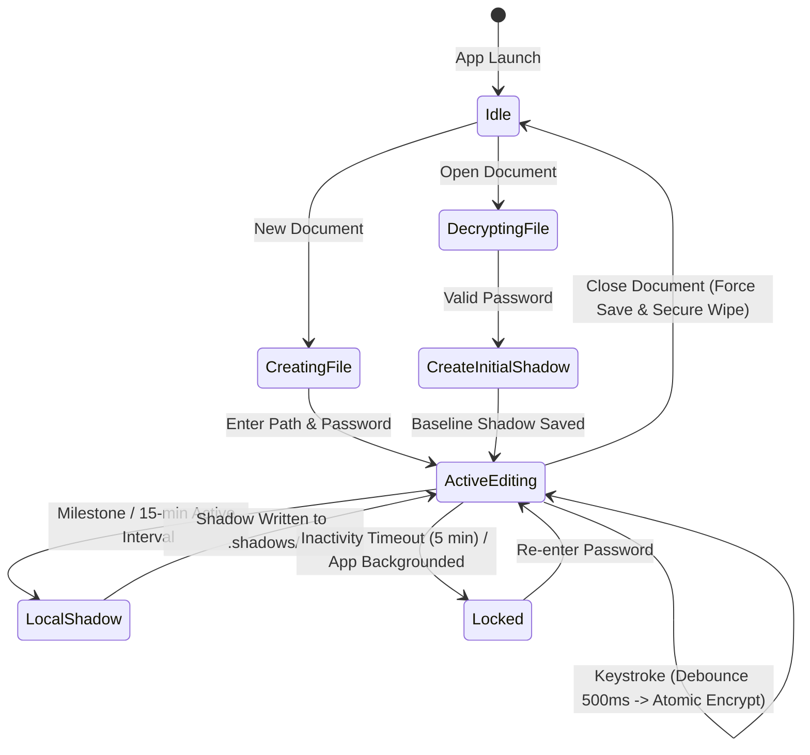

# Project Specification: EncNotePad (Local-First with On-Device Shadow Copies)

## 1. Executive Summary & Core Principles

**EncNotePad** is a secure, lightweight, cross-platform structured text editor designed for handling sensitive notes, credentials, and personal records. It enforces authenticated client-side encryption on save and decryption on open.

Data is structured in an intuitive hierarchical format (**Sections** containing **Parts**) rather than a flat text stream, optimizing it for organized personal records, project credentials, and financial notes.

To guarantee zero data loss without depending on remote servers or third-party cloud infrastructure, EncNotePad implements a robust **On-Device Shadow Copy (Local Version History)** engine.

### 1.1 Core Principles

- **100% Offline & Zero-Knowledge (v1 Focus):** No data leaves the user's device. No cloud accounts, remote servers, telemetry, or network permissions are required.
- **On-Device Shadow Copies:** Every major editing session and milestone automatically creates an immutable, encrypted local shadow copy (snapshot). Users can preview and roll back changes at any time.
- **Zero Plaintext Persistence:** Plaintext is never written to disk, swap, or temporary cache files. All shadow copies are fully encrypted `.enp` binary files.
- **Cross-Platform Consistency:** Identical cryptographic format and file compatibility across **Windows**, **Android**, and **iOS** from a single Flutter codebase.

---

## 2. Technical Architecture

### 2.1 Technology Stack

- **Framework:** **Flutter 3.x (Dart 3.x)** (Single codebase targeting Windows desktop, Android, and iOS).
- **Architecture Pattern:** Clean Architecture / Feature-First with state management (`flutter_bloc` or `Riverpod`).
- **Character Encoding:** Strict **UTF-8** enforcement across memory buffers, JSON serialization, and cryptographic inputs to natively support multilingual text, Indian language scripts (Devanagari, Bengali, Tamil, Telugu, Gujarati, etc.), and Unicode emojis.
- **Threading / Concurrency:** Heavy computational tasks (Argon2id key derivation, JSON serialization, AES-256-GCM encryption/decryption) run in **Dart Background Isolates** (`Isolate.run` or persistent worker isolates) to ensure the UI thread never drops below 60/120 FPS.
- **Networking:** Completely disabled. Omit `android.permission.INTERNET` from `AndroidManifest.xml` and zero network entitlements in desktop/iOS configs.

### 2.2 Typography & Indian Language Support

- **Font Stack:** Bundled open-source fonts with comprehensive Unicode glyph coverage (e.g., Google Noto Sans / Nirmala UI fallback).
- **IME Compatibility:** Native Input Method Editor (IME) support across Windows (TSF), Android, and iOS virtual keyboards, including complex conjunct character rendering and diacritics.

---

## 3. Cryptographic Specification & File Format

### 3.1 Cryptographic Primitives

- **Authenticated Encryption (AEAD):** **AES-256-GCM** (Galois/Counter Mode).
  - _Key Length:_ 256 bits (32 bytes).
  - _Nonce / IV:_ 96 bits (12 bytes) generated via a cryptographically secure random number generator (`Random.secure()`). **A fresh, unique nonce is generated on every auto-save and shadow copy creation.**
  - _Authentication Tag:_ 128 bits (16 bytes).
- **Key Derivation Function (KDF):** **Argon2id** (RFC 9106)
  - _Salt:_ 128 bits (16 bytes) cryptographically secure random salt generated per document.
  - _Parameters:_ Memory Cost ($m$) = 64 MB (65,536 KiB), Time Cost ($t$) = 3 iterations, Parallelism ($p$) = 4 threads.
  - _Fallback:_ PBKDF2-HMAC-SHA256 (600,000 iterations) if Argon2 FFI bindings are unavailable on the host.

### 3.2 Binary File Specification (`.enp`)

Both the primary document file and all local shadow copy files use the exact same secure `.enp` binary layout:

```
+------------------------------------------------------------------------------------+
| Magic Bytes | Version | Salt      | Nonce / IV | Ciphertext           | Auth Tag   |
| 4 bytes     | 1 byte  | 16 bytes  | 12 bytes   | Variable length      | 16 bytes   |
| 'E','N','P','1' | 0x01 | Crypt-Salt| Random IV  | AES-256-GCM Payload  | GCM Tag    |
+------------------------------------------------------------------------------------+
```

- **Magic Header (4 bytes):** ASCII `ENP1` (0x45, 0x4E, 0x50, 0x31) to validate file integrity and prevent parsing non-EncNotePad files.
- **Format Version (1 byte):** `0x01` (allows forward-compatible cryptographic upgrades).
- **Salt (16 bytes):** Random salt for the KDF.
- **Nonce (12 bytes):** Unique 96-bit initialization vector.
- **Ciphertext (Variable):** Encrypted UTF-8 encoded JSON payload.
- **Auth Tag (16 bytes):** GCM authentication tag for tamper detection and password verification.

### 3.3 Plaintext Document Schema (In-Memory JSON)

```json
{
  "meta": {
    "version": "1.0",
    "app": "EncNotePad",
    "created_at": "2026-11-20T10:30:00.000Z",
    "updated_at": "2026-11-20T10:35:00.000Z"
  },
  "content": [
    {
      "id": "sec_b7f9a81e-45a1-4328-98e3-a1286b7201c1",
      "title": "Personal Finance",
      "is_collapsed": false,
      "order": 0,
      "parts": [
        {
          "id": "prt_f3c8a912-78d2-491b-85d7-e89c62131920",
          "title": "Bank Accounts",
          "body": "State Bank of India\nA/C: 1234567890\nIFSC: SBIN0001234",
          "order": 0
        }
      ]
    }
  ]
}
```

---

## 4. On-Device Shadow Copy Engine (Local Version History)

To protect users against accidental deletion, file corruption, or unintended edits without requiring cloud storage, EncNotePad implements a local **On-Device Shadow Copy Engine**.

```
Document Directory:
├── MyVault.enp                     (Current working active file)
├── .MyVault.enp.tmp                (Transient atomic write file)
└── .MyVault_shadows/               (Local encrypted snapshot repository)
    ├── shadow_001_20261120_140000.enp
    ├── shadow_002_20261120_153012.enp
    ├── shadow_003_20261120_164500.enp
    └── manifest.json               (Encrypted/Hashed metadata: version, timestamp, size)
```

### 4.1 When Local Shadow Copies Are Created

1.  **Session Open Snapshot:** When an existing document is opened and decrypted, the initial state on disk is immediately archived as a baseline shadow copy for that session.
2.  **Milestone Auto-Snapshot:** During active editing, a new shadow copy is captured every **15 minutes of active editing** (or after major structural changes, such as deleting a Section).
3.  **Manual Snapshot:** User can trigger **File > Create Shadow Copy Now** (`Ctrl+Shift+B` / `Cmd+Shift+B`).

### 4.2 Local Retention & Rotation Policy

- **Default Capacity:** Stores the **last 15 local shadow copies** per document.
- **FIFO Rotation:** When the 16th shadow copy is generated, the oldest snapshot in the `.shadows` folder is automatically purged.
- **Storage Overhead:** Because notes are lightweight text (typically 5 KB – 50 KB each), 15 shadow copies consume less than **1 MB of local disk space**.

### 4.3 In-App Point-in-Time Recovery Workflow

1.  User clicks **File > Version History (Shadow Copies)** or the clock icon in the toolbar.
2.  The modal dialog displays a chronologically sorted list of local snapshots:
    - _Timestamp_ (e.g., `Today at 15:30:12`)
    - _Trigger Type_ (Session Start, Milestone, Manual)
    - _File Size & Section Count_
3.  **Encrypted Preview:** Selecting any snapshot loads it into memory and decrypts it using the current Session Key to show a read-only preview without modifying the active file.
4.  **One-Click Restore:** Clicking **"Restore this Snapshot"** replaces the active document in memory, triggers an immediate atomic save to `<name>.enp`, and records a new recovery shadow copy.

---

## 5. Functional Requirements & Core Workflows

### 5.1 Document Lifecycle



#### 5.1.1 New Document

1.  User clicks **New Document** (`Ctrl+N`).
2.  Dialog prompts for file save path and master password (with confirmation and password strength meter).
3.  App generates salt, derives key via Argon2id in background isolate, and creates empty document structure.
4.  App writes `<name>.enp` and creates the `.name_shadows/` directory with `shadow_001.enp`.

#### 5.1.2 Open Document

1.  User clicks **Open Document** (`Ctrl+O`).
2.  File selection dialog selects `.enp` file.
3.  Password prompt displayed.
4.  Background isolate reads header, verifies `ENP1` magic bytes, derives candidate key, and validates AES-256-GCM auth tag.
5.  On success, copies current file as a baseline shadow copy in `.shadows/`, then renders UI.
6.  On failure (wrong password or corruption), displays clear error with a 500ms anti-brute-force delay.

#### 5.1.3 Atomic Auto-Save Pipeline

1.  **Debounce 500ms:** Triggers 500ms after last keystroke or structure edit.
2.  **Isolate Encryption:** Re-encrypts in-memory JSON with a **new unique 12-byte Nonce**.
3.  **Atomic Write:**
    - Write ciphertext to `<filename>.enp.tmp`.
    - Flush file buffers to disk (`flush()`).
    - Atomically rename `<filename>.enp.tmp` to `<filename>.enp`.
4.  **UI Feedback:** Subtle status bar text: _"All changes saved locally"_.

#### 5.1.4 Inactivity Auto-Lock & App Lifecycle

- **Inactivity Timer:** Configurable (default: 5 minutes of no keyboard/mouse input). When triggered, the Session Key and document state are purged from memory, and the UI displays an unlock screen.
- **Mobile App Backgrounding:** Locks immediately upon being backgrounded (`paused` on Android, `sceneDidEnterBackground` on iOS).
- **Screen Privacy:**
  - Android: `FLAG_SECURE` prevents screenshots and recent apps thumbnails.
  - iOS: Privacy blur overlay during task switcher transitions.

---

## 6. User Interface Design

### 6.1 Desktop Layout (Windows)

```text
+------------------------------------------------------------------------------------+
| EncNotePad - [PersonalVault.enp]                               [ - ][ □ ][ X ]     |
| File   Edit   Security   Help                                                      |
+------------------------------------------------------------------------------------+
| [🔍 Search notes... (Ctrl+F)    ]  [+ Add Section]  [🕒 Shadow Copies]  [🔒 Lock]  |
|                                                                                    |
| +--------------------------------------------------------------------------------+ |
| | ▼ Section: Banking & Cards                                          [▲][▼][🗑]  | |
| |   +--------------------------------------------------------------------------+ | |
| |   | Part Title: HDFC Salary Account                                  [▲][▼][🗑] | |
| |   | [ A/C No: 50100234567890                                              ] | |
| |   | [ IFSC: HDFC0001234                                                   ] | |
| |   +--------------------------------------------------------------------------+ | |
| |   [+ Add Part]                                                                 | |
| +--------------------------------------------------------------------------------+ |
|                                                                                    |
| +--------------------------------------------------------------------------------+ |
| | ▶ Section: Cloud & Server Credentials (4 parts collapsed)           [▲][▼][🗑]  | |
| +--------------------------------------------------------------------------------+ |
+------------------------------------------------------------------------------------+
| Status: All changes saved (Local) | 2 Sections | 8 Local Shadow Copies Available   |
+------------------------------------------------------------------------------------+
```

### 6.2 Local Shadow Copies Dialog

```text
+------------------------------------------------------------------------------------+
| Local Version History (Shadow Copies)                                  [ X ]       |
+------------------------------------------------------------------------------------+
| Select an on-device snapshot to preview or restore:                                |
|                                                                                    |
|  [●] Current Working File  - Today, 17:05:10  (Active)                             |
|  [ ] Shadow #008 (Milestone) - Today, 16:50:00  (4.2 KB)                           |
|  [ ] Shadow #007 (Milestone) - Today, 16:35:00  (4.1 KB)                           |
|  [ ] Shadow #006 (Session Open) - Today, 16:00:12  (3.9 KB)                        |
|  [ ] Shadow #005 (Milestone) - Yesterday, 21:15:30 (3.8 KB)                        |
|                                                                                    |
| +--------------------------------------------------------------------------------+ |
| | Preview of Shadow #007:                                                        | |
| | Section: Banking & Cards (1 Part)                                              | |
| | • Part: HDFC Salary Account                                                    | |
| +--------------------------------------------------------------------------------+ |
|                                                                                    |
|   [ Close ]                     [ Export Copy... ]          [ Restore This Snapshot]|
+------------------------------------------------------------------------------------+
```

---

## 7. Development Roadmap & Phasing

### Phase 1: Core Desktop MVP with On-Device Shadow Copies (v1.0)

- [x] Cryptographic engine (Argon2id + AES-256-GCM in Dart background isolate).
- [x] Binary file serializer/deserializer with `ENP1` magic header and versioning.
- [x] Document hierarchical state store (Add/Edit/Delete/Collapse Sections & Parts).
- [x] Debounced 500ms atomic auto-save (`.enp.tmp` -> `.enp`).
- [x] **On-Device Shadow Copy Engine** (`.shadows/` directory, 15-snapshot FIFO rotation, preview & restore dialog).
- [x] Inactivity auto-lock and RAM zeroization.

### Phase 2: Mobile Adaptation (v1.1)

- [ ] Android and iOS native mobile layouts (collapsible accordions, bottom sheets, FAB).
- [ ] Mobile sandboxed storage handling for local shadow copies.
- [ ] Biometric quick unlock (Fingerprint / Face ID wrapping the session key via OS Keystore/Keychain).
- [ ] Screen privacy (`FLAG_SECURE` / iOS scene blur).

---

## 8. Future Scope & Architecture Roadmap (On Hold for v2)

The following capabilities are architecturally designed but held for a future major release:

### 8.1 Zero-Knowledge E2EE Cloud Sync

- **Concept:** Optional multi-device synchronization where files are encrypted client-side prior to transit.
- **Key Separation:** Master key splits into `Document Encryption Key` (local only) and `Cloud Auth Key` (hashed for server auth).
- **Potential Backend Stack:** Cloudflare R2 + D1 (Serverless) or Supabase (PostgreSQL + S3 storage) or self-hosted VPS.

### 8.2 Cloud-Synced Shadow Copies

- Server-side immutable snapshot archive mirroring the on-device shadow copies.
- Multi-device revision history and branch conflict resolution.

### 8.3 Rich Content

- Markdown syntax highlighting and rendering in Part body text.
- Encrypted attachment storage inside Parts (images, small PDFs).
